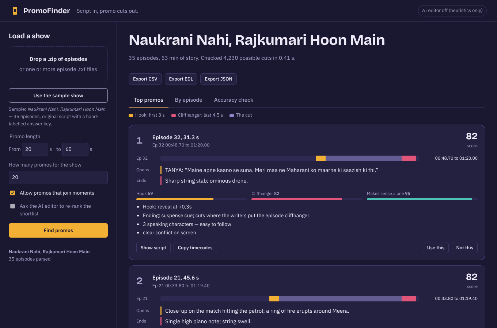
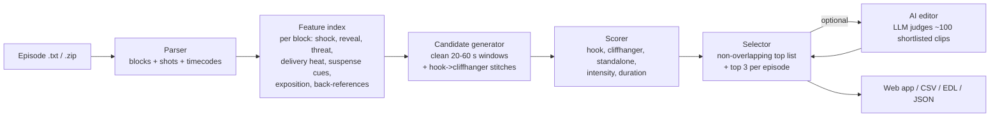

# PromoFinder

**Reads a micro-drama screenplay and finds the best 20–60 second promo clips in it: the right moments, with exact start and end timecodes.**

Vertical micro-drama apps release new shows every week. Each one needs promos for Instagram, YouTube Shorts and TikTok: short clips cut from the show that pull in new viewers. Today an editor watches every episode and picks those moments by hand. PromoFinder reads the script instead and hands the editor a ranked shortlist, with a reason for every pick. The editor can export that shortlist as an EDL and drop it into Premiere or Resolve.

A good promo, and what PromoFinder scores:

| | What it means | How it is detected |
|---|---|---|
| **Hook** | Something in the first 3 seconds makes a scrolling viewer stop: a slap, a reveal, a shocking line | Visual shock in stage directions, reveals and threats in dialogue, how heated the delivery is, position within the first 3 s |
| **Cliffhanger** | The clip cuts at an unresolved moment | Open questions, threats, reveals, suspense sound and camera cues in the last 4.5 s. Endings that wrap things up (hugs, laughter, relief) are penalised |
| **Makes sense alone** | Someone who has never seen the show can follow it | Penalises starting mid-conversation, references to earlier episodes, dream and flashback beats, exposition and comic side plots. Rewards a clear conflict between a few characters |



---

## What it does

- **Upload a show:** a `.zip` of episode `.txt` files, or individual episodes, in the standard timecoded screenplay format (camera, action, dialogue and sound blocks, each with `Start | End`). A 35-episode sample show is built in.
- **Finds every possible cut:** all clean 20–60 s windows, which start and end on shot boundaries and never cut a line of dialogue in half. It also builds **stitched promos** that join an opening hook to a cliffhanger from the same episode or a later one. On the sample, that is about 4,200 cuts scored in about 0.3 s.
- **Ranks and de-duplicates:** you get a show-level top list (no two promos reuse the same footage, at most 2 per episode) and a top-3 shortlist for every episode.
- **Explains every pick:** the opening line, the closing beat, three score bars, reasons and warnings. You can expand the full script of the clip, with the hook and cliffhanger zones highlighted.
- **Optional AI editor:** an LLM re-judges the shortlist (about 100 clips, not the whole show) and its verdict is blended with the heuristic score. Any OpenAI-compatible provider works (Groq, Gemini, OpenAI, OpenRouter) as well as Anthropic. If the LLM fails, the tool falls back to the heuristic ranking without breaking.
- **Exports:** CSV for spreadsheets, CMX3600 **EDL** for editing software (one reel per episode), and JSON for automation.
- **Editor feedback:** "Use this" and "Not this" buttons are stored in SQLite, so you can measure which suggestions editors actually use.
- **Built-in accuracy check:** compares the picks against an answer key of hand-picked promos and a naive baseline.

## Results on the sample show

The sample show, *Naukrani Nahi, Rajkumari Hoon Main*, is an original 35-episode Hindi/Hinglish royal-family drama: 53 minutes and about 28k words. It comes with a hand-labelled answer key of **38 promos** (10 of them stitched) and **16 trap moments**. Traps are loud or dramatic lines that a good editor would *not* open or close a promo on.

The baseline is a simple rule: take the last ~35 seconds of each episode, where writers put the cliffhanger.

| First pick for each episode | PromoFinder | Simple rule |
|---|---|---|
| Matches the editor's promo (IoU ≥ 0.5) | 77% | 80% |
| Overlaps the editor's promo (IoU ≥ 0.3) | **91%** | 83% |
| Starts within 3 s of the editor's hook | **68%** | 11% |
| Falls for a trap moment | **3%** | 6% |

| Other measures | |
|---|---|
| Episodes where the top 3 contain the editor's promo (IoU ≥ 0.5) | 80% (94% at IoU ≥ 0.3) |
| First pick ends within 3 s of the editor's cut | 96% |
| Show-level top 20 that match an editor's promo | 85% |

**How to read this honestly.** Most hand-picked promos in this sample end at the episode cliffhanger, which makes "last 35 seconds" a strong baseline on overlap alone. Where PromoFinder clearly wins is *where the promo starts*. A promo that does not open on a hook fails on social media, and the baseline almost never finds the hook (11% vs 68%).

The same author wrote both the script and the answer key. The scoring weights come from promo-editing rules, not from fitting the key. After the first evaluation run, three product decisions were made:
- an episode's shortlist only uses footage from that episode;
- stitched promos carry an editing-cost penalty;
- starting mid-conversation is penalised harder.

Treat these as development-set numbers. The next step is a held-out show labelled by a different editor.

Reproduce them with `python scripts/evaluate.py data/sample_show data/sample_answer_key.json`. They are also guarded by a regression test.


## How it works



`score = 0.30 hook + 0.30 cliffhanger + 0.20 standalone + 0.15 intensity + 0.05 duration − 0.08 per extra stitched moment`

- **Clean cuts only.** A window may start and end only on shot boundaries where no one is mid-sentence. "Cut to black" frames are never included.
- **Visual beats over mentioned ones.** A slap in a stage direction counts fully. The word *thappad* inside a line of dialogue counts as a mention only.
- **Delivery matters.** A threat delivered *(Furious)* scores higher than the same words delivered *(Calm)*.
- **Writers' cliffhangers.** Ending exactly where the episode ends earns a bonus, because writers design those beats to be unresolved.
- **Why heuristics first, AI second.** The heuristics are free, instant and explainable, and they handle thousands of cuts. The LLM is slower and costs money, but it understands context ("is this a side plot?"), so it only judges the shortlist.

## Run it

```bash
pip install -r requirements.txt
uvicorn app.main:app --reload          # open http://localhost:8000 and click "Use the sample show"
```

Command line:

```bash
python scripts/find_promos.py data/sample_show --top 10 --csv promos.csv --edl promos.edl
python scripts/evaluate.py data/sample_show data/sample_answer_key.json
pytest -q                              # 20 tests: parser, scoring, selection, LLM fallback, API
```

Turn on the AI editor by copying `.env.example` and setting a provider and key (Groq and Gemini have free tiers):

```bash
export PROMOFINDER_LLM_PROVIDER=groq
export PROMOFINDER_LLM_API_KEY=...
```

## Deploy

The app is one Docker container with no external services. SQLite stores jobs and feedback.

- **Render:** push to GitHub, then create a *New Blueprint* from the repo. `render.yaml` sets the service up. Add the LLM key in the dashboard if you want the AI editor.
- **Hugging Face Spaces:** create a *Docker* Space, push the repo, and set the Space's port to 8000 (or set `PORT=7860`). Add `PROMOFINDER_LLM_*` as Space secrets.
- **Railway / Fly.io / any VM:** `docker build -t promofinder . && docker run -p 8000:8000 promofinder`

## API

| Method | Path | What it does |
|---|---|---|
| `POST` | `/api/analyze` | multipart: `files` (.zip/.txt) or `use_sample=true`; options `min_len`, `max_len`, `top_k`, `allow_stitched`, `use_llm`. Returns promos, per-episode picks and a `job_id` |
| `GET` | `/api/jobs/{id}` | Fetch a previous result |
| `GET` | `/api/jobs/{id}/export?format=csv\|edl\|json` | Download the cut list |
| `POST` | `/api/jobs/{id}/evaluate` | Score against an answer key (built in for the sample) |
| `POST` | `/api/feedback` | `{job_id, promo_id, vote: 1\|-1}` |
| `GET` | `/api/health`, `/api/config` | Status and defaults |

Interactive docs are at `/docs`.

## Project layout

```
promofinder/      engine: parser, lexicon, features, candidates, scoring, selection, llm, evaluate, exporters
app/              FastAPI app + static frontend (no build step, self-hosted fonts)
data/             sample show (35 episodes), answer key, show bible
scripts/          find_promos.py, evaluate.py
tests/            pytest suite
```

## Limitations and next steps

- It reads the **script**, not the footage. Performance, music and visual quality only come in through what the script describes. A next version could check the picked timecodes against the actual video: face close-ups, audio peaks.
- The cue lexicon covers English stage directions and Hinglish dialogue. Other languages need their own word lists, or the AI editor.
- Evaluation so far is one show with one labeller. Editor feedback from the app is the path to tuning the weights on real usage.
