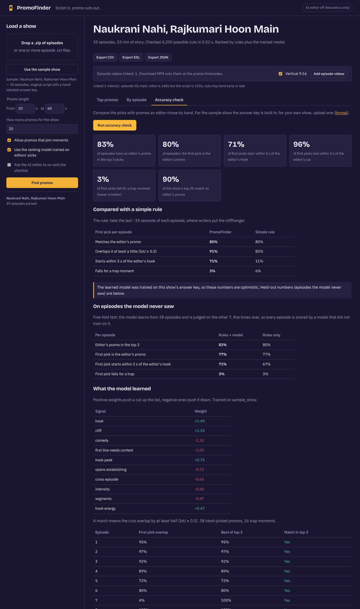
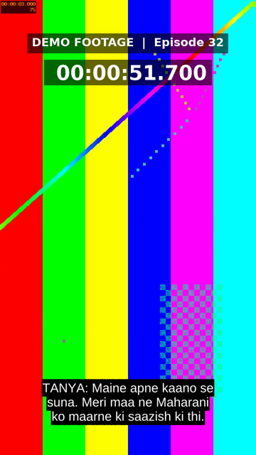
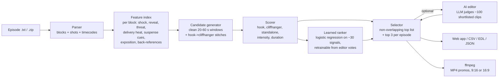

# PromoFinder

**Reads a micro-drama screenplay and finds the best 20–60 second promo clips in it: the right moments, with exact start and end timecodes. Add the episode videos and it hands back ready-to-post MP4s.**

**Live demo:** https://promofinder-r9ns.onrender.com (free server: the first load can take ~50 s while it wakes up)

Vertical micro-drama apps release new shows every week. Each one needs promos for Instagram, YouTube Shorts and TikTok: short clips cut from the show that pull in new viewers. Today an editor watches every episode and picks those moments by hand. PromoFinder reads the script instead and hands the editor a ranked shortlist, with a reason for every pick. The editor can export that shortlist as an EDL and drop it into Premiere or Resolve.

A good promo, and what PromoFinder scores:

| | What it means | How it is detected |
|---|---|---|
| **Hook** | Something in the first 3 seconds makes a scrolling viewer stop: a slap, a reveal, a shocking line | Visual shock in stage directions, reveals and threats in dialogue, how heated the delivery is, position within the first 3 s |
| **Cliffhanger** | The clip cuts at an unresolved moment | Open questions, threats, reveals, suspense sound and camera cues in the last 4.5 s. Endings that wrap things up (hugs, laughter, relief) are penalised |
| **Makes sense alone** | Someone who has never seen the show can follow it | Penalises starting mid-conversation, references to earlier episodes, dream and flashback beats, exposition and comic side plots. Rewards a clear conflict between a few characters |


---

## What it does

- **Upload a show:** a `.zip` of episode `.txt` files, or individual episodes, in the standard timecoded screenplay format (camera, action, dialogue and sound blocks, each with `Start | End`). A 35-episode sample show is built in.
- **Finds every possible cut:** all clean 20–60 s windows, which start and end on shot boundaries and never cut a line of dialogue in half. It also builds **stitched promos** that join an opening hook to a cliffhanger from the same episode or a later one. On the sample, that is about 4,200 cuts scored in about 0.3 s.
- **Ranks and de-duplicates:** you get a show-level top list (no two promos reuse the same footage, at most 2 per episode) and a top-3 shortlist for every episode.
- **Explains every pick:** the opening line, the closing beat, three score bars, reasons and warnings. You can expand the full script of the clip, with the hook and cliffhanger zones highlighted.
- **Ready MP4 promos:** upload the episode videos (named like `episode-05.mp4`) and download each promo as an MP4, vertical 9:16 or 16:9. It is cut with ffmpeg at the exact timecodes, and stitched promos are joined. A script that doesn't match its video length gets a warning. Shows with no video can still download a **demo MP4**: a test pattern showing the episode timecode and the script's dialogue, so you can check the cut lands on the right line.
- **Learned ranking (v2):** a logistic-regression ranker trained on editors' picks sits on top of the rules (see below). Editor votes from the app can retrain it.
- **Optional AI editor:** an LLM re-judges the shortlist (about 100 clips, not the whole show) and its verdict is blended with the heuristic score. Any OpenAI-compatible provider works (Groq, Gemini, OpenAI, OpenRouter) as well as Anthropic. If the LLM fails, the tool falls back to the heuristic ranking without breaking.
- **Exports:** CSV for spreadsheets, CMX3600 **EDL** for editing software (one reel per episode), and JSON for automation.
- **Editor feedback:** "Use this" and "Not this" buttons are stored in SQLite, so you can measure which suggestions editors actually use.
- **Built-in accuracy check:** compares the picks against an answer key of hand-picked promos and a naive baseline.

## Results on the sample show

The sample show, *Naukrani Nahi, Rajkumari Hoon Main*, is an original 35-episode Hindi/Hinglish royal-family drama: 53 minutes and about 28k words. It comes with a hand-labelled answer key of **38 promos** (10 of them stitched) and **16 trap moments**. Traps are loud or dramatic lines that a good editor would *not* open or close a promo on.

The baseline is a simple rule: take the last ~35 seconds of each episode, where writers put the cliffhanger.

| First pick for each episode | PromoFinder (rules, v1) | Simple rule |
|---|---|---|
| Matches the editor's promo (IoU ≥ 0.5) | 77% | 80% |
| Overlaps the editor's promo (IoU ≥ 0.3) | **91%** | 83% |
| Starts within 3 s of the editor's hook | **68%** | 11% |
| Falls for a trap moment | **3%** | 6% |

| Other measures | |
|---|---|
| Episodes where the top 3 contain the editor's promo (IoU ≥ 0.5) | 80% (94% at IoU ≥ 0.3) |
| First pick ends within 3 s of the editor's cut | 96% |
| Show-level top 20 that match an editor's promo | 85% |

### v2: learned ranking, tested on episodes it never saw

The rule weights above were set by hand. In v2 a logistic-regression ranker learns from the answer key how much each signal matters. It uses about 30 signals: the five scores plus raw features such as "starts mid-conversation", "comic beat", "ends where the episode ends" and "hook energy". The final score is half rules, half model.

**Testing it fairly:** the episodes are split into 5 groups. The model trains on 4 groups (28 episodes) and is judged on the 5th (7 episodes it never saw), five times over. Every episode is therefore scored by a model that did not learn from it.

| Per episode, held out | Rules + model | Rules only |
|---|---|---|
| Editor's promo in the top 3 | **83%** | 80% |
| First pick is the editor's promo | 77% | 77% |
| First pick starts within 3 s of the editor's hook | **71%** | 67% |
| First pick falls for a trap | 3% | 3% |

The gain is real but small: one or two episodes out of 35. The bigger win is that the weights are now learned, so they improve as editors vote.

A first attempt counted a cut as "correct" if it merely overlapped the editor's promo. The model then learned to prefer long clips, and its hook placement got *worse* (40%). The label now requires the start and the end to sit within 2–3 s of the editor's cut, which is what an editor actually cares about. A model trained only on the answer key, without the rules, did slightly worse than the blend, so the app uses the blend.

What the model learned matches editing sense. The biggest positive weights are hook and cliffhanger. The biggest negative weights are comic beats, first lines that need earlier context, establishing shots and cross-episode stitches. The app shows these weights on the accuracy page.

Reproduce with `python scripts/train_ranker.py data/sample_show data/sample_answer_key.json`.

**How to read this honestly.** Most hand-picked promos in this sample end at the episode cliffhanger, which makes "last 35 seconds" a strong baseline on overlap alone. Where PromoFinder clearly wins is *where the promo starts*. A promo that does not open on a hook fails on social media, and the baseline almost never finds the hook (11% vs 68%).

The same author wrote both the script and the answer key. The scoring weights come from promo-editing rules, not from fitting the key. After the first evaluation run, three product decisions were made:
- an episode's shortlist only uses footage from that episode;
- stitched promos carry an editing-cost penalty;
- starting mid-conversation is penalised harder.

Treat these as development-set numbers. The next step is a held-out show labelled by a different editor.

Reproduce them with `python scripts/evaluate.py data/sample_show data/sample_answer_key.json`. They are also guarded by a regression test.



A frame from a demo MP4 (test pattern + the script line being spoken + episode timecode):



## How it works



`score = 0.30 hook + 0.30 cliffhanger + 0.20 standalone + 0.15 intensity + 0.05 duration − 0.08 per extra stitched moment`

- **Clean cuts only.** A window may start and end only on shot boundaries where no one is mid-sentence. "Cut to black" frames are never included.
- **Visual beats over mentioned ones.** A slap in a stage direction counts fully. The word *thappad* inside a line of dialogue counts as a mention only.
- **Delivery matters.** A threat delivered *(Furious)* scores higher than the same words delivered *(Calm)*.
- **Writers' cliffhangers.** Ending exactly where the episode ends earns a bonus, because writers design those beats to be unresolved.
- **Why heuristics first, AI second.** The heuristics are free, instant and explainable, and they handle thousands of cuts. The LLM is slower and costs money, but it understands context ("is this a side plot?"), so it only judges the shortlist.

## Run it

```bash
pip install -r requirements.txt
uvicorn app.main:app --reload          # open http://localhost:8000 and click "Use the sample show"
```

Command line:

```bash
python scripts/find_promos.py data/sample_show --top 10 --csv promos.csv --edl promos.edl
python scripts/evaluate.py data/sample_show data/sample_answer_key.json
python scripts/train_ranker.py data/sample_show data/sample_answer_key.json   # held-out test + retrain
pytest -q                              # 28 tests: parser, scoring, ranker, MP4 export, LLM fallback, API
```

Turn on the AI editor by setting a provider and key. Locally use environment variables; on Render use the service's **Environment** page. Never put keys in the repo.

```bash
export PROMOFINDER_LLM_PROVIDER=gemini      # or groq, openai, openrouter, anthropic, custom
export PROMOFINDER_LLM_API_KEY=...
export PROMOFINDER_LLM_MODEL=...            # optional: the provider's current model name
```

Free tiers allow only a few requests and tokens per minute, so the AI editor judges at most 60 clips per run (`PROMOFINDER_LLM_MAX_CLIPS`), one batch at a time. It waits when the provider says "try again in N s". Gemini's free tier has far more tokens per minute than Groq's, which suits this job better. If a call fails, the app shows the provider's reason (bad key, unknown model, rate limit) and keeps the rule-based ranking.

## Deploy

The app is one Docker container (Python + ffmpeg) with no external services. SQLite stores jobs and feedback.

On Render's free plan, uploaded videos and retrained models live on temporary disk: they reset when the service restarts. The free CPU is slow, so cutting one MP4 can take up to a minute.

- **Render:** push to GitHub, then create a *New Blueprint* from the repo. `render.yaml` sets the service up. Add the LLM key in the dashboard if you want the AI editor.
- **Hugging Face Spaces:** create a *Docker* Space, push the repo, and set the Space's port to 8000 (or set `PORT=7860`). Add `PROMOFINDER_LLM_*` as Space secrets.
- **Railway / Fly.io / any VM:** `docker build -t promofinder . && docker run -p 8000:8000 promofinder`

## API

| Method | Path | What it does |
|---|---|---|
| `POST` | `/api/analyze` | multipart: `files` (.zip/.txt) or `use_sample=true`; options `min_len`, `max_len`, `top_k`, `allow_stitched`, `use_llm`. Returns promos, per-episode picks and a `job_id` |
| `GET` | `/api/jobs/{id}` | Fetch a previous result |
| `GET` | `/api/jobs/{id}/export?format=csv\|edl\|json` | Download the cut list |
| `POST` | `/api/jobs/{id}/evaluate` | Score against an answer key (built in for the sample) |
| `POST` | `/api/feedback` | `{job_id, promo_id, vote: 1\|-1}` |
| `POST` | `/api/jobs/{id}/videos` | Upload episode videos (`episode-05.mp4` …); they are matched to episodes by file name |
| `GET` | `/api/jobs/{id}/clip?promo_id=…&vertical=true&demo=false` | Download a promo as MP4 |
| `GET` | `/api/model` | The learned ranker's top weights and held-out scores |
| `POST` | `/api/model/retrain` | Retrain on the answer key + all editor votes (header `x-admin-token`) |
| `GET` | `/api/health`, `/api/config` | Status and defaults |

Interactive docs are at `/docs`.

## Project layout

```
promofinder/      engine: parser, lexicon, features, candidates, scoring, selection, llm, evaluate, exporters
app/              FastAPI app + static frontend (no build step, self-hosted fonts)
data/             sample show (35 episodes), answer key, show bible
scripts/          find_promos.py, evaluate.py
tests/            pytest suite
```

## Limitations and next steps

- **Script-to-video alignment:** if the edit drifts from the script's timecodes, a speech-to-text model (e.g. Whisper) could line dialogue up with the audio and fix the cut points automatically. Today there is a duration check and an offset option.
- **Meaning, not just words:** a multilingual sentence-embedding model would catch hooks the cue lists miss. For example, the line "her hand swings across her face" needed a new verb added by hand.
- **Learn from real results:** feed back each posted promo's 3-second hold rate, click-through and installs, so the ranker learns what brings viewers, not just what editors pick.

- It reads the **script**, not the footage. Performance, music and visual quality only come in through what the script describes. A next version could check the picked timecodes against the actual video: face close-ups, audio peaks.
- The cue lexicon covers English stage directions and Hinglish dialogue. Other languages need their own word lists, or the AI editor.
- Evaluation so far is one show with one labeller. Editor feedback from the app is the path to tuning the weights on real usage.
